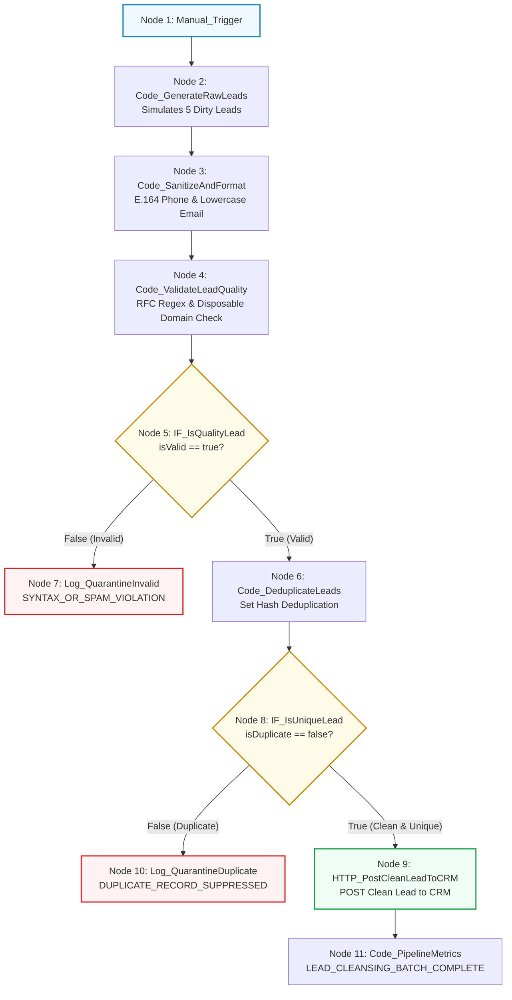

# Requirement Document: N8N Hands-On Intermediate Course
## Topic 3: Data Validation, Cleaning & Duplicate Prevention

---

## 1. Document Control

| Field | Value |
| :--- | :--- |
| **Document Title** | Topic 3: Data Validation, Cleaning & Duplicate Prevention - Requirement File |
| **Course** | N8N - Hands On Intermediate Course (Level 2) |
| **Target Audience** | Automation Builders, System Integrators, QA Engineers |
| **Version** | 1.0 |
| **Status** | Approved |
| **Last Updated** | June 25, 2026 |
| **Prepared By** | Lead Automation Architect |

---

## 2. Learning Concepts & Objectives

### 2.1 Course Objective
Build an enterprise lead intake sanitization and deduplication pipeline in n8n. The workflow ingests raw, messy marketing leads, normalizes phone numbers into E.164 standard format, validates email structures using RFC regex, filters out disposable/temporary email domains, removes intra-batch duplicates using set-based hash indexing, dispatches clean unique leads to a mock CRM, and routes bad/duplicate leads to segregated quarantine logs.

### 2.2 Learning Scope
* **Marketing Lead Ingestion:** Emitting mock batches of dirty marketing leads with common real-world flaws (missing country codes, malformed email syntax, disposable domains, and intra-batch duplicates).
* **Phone Sanitization & E.164 Formatting:** Stripping non-numeric characters and standardizing telephone numbers to the ITU-T E.164 international standard (`+1` for 10-digit US numbers).
* **Multi-Layer Quality Screening:** Applying RFC 5322 regex checks for email syntax, blacklisting temporary email domains (`mailinator.com`, `tempmail.com`, `10minutemail.com`, `guerrillamail.com`, `trashmail.com`), and enforcing minimum name length constraints.
* **Intra-Batch Deduplication:** Leveraging JavaScript `Set` data structures to detect duplicate submissions across email and phone fingerprints in a single execution batch.
* **Segregated Quarantine Architecture:** Routing syntax/spam rejections to `Log_QuarantineInvalid` and duplicate records to `Log_QuarantineDuplicate` for auditing and compliance.
* **CRM Synchronization & Batch Analytics:** Posting clean leads to a CRM ingestion endpoint and compiling execution batch metrics.

---

## 3. Workflow Architecture

---

## 4. Functional Requirements

| Requirement ID | Section | Requirement Description | Priority |
| :--- | :--- | :--- | :--- |
| **REQ-001** | Lead Ingestion | The workflow shall simulate or ingest raw marketing submissions containing name, email, phone, company, and notes. | High |
| **REQ-002** | E.164 Phone Normalization | Telephone numbers shall be stripped of formatting characters (dashes, spaces, parentheses) and standardized to E.164 international notation. | High |
| **REQ-003** | RFC Email Validation | Incoming emails shall be validated against the RFC 5322 regex pattern; malformed addresses shall be flagged immediately. | High |
| **REQ-004** | Disposable Domain Filtering | Domains matching known throwaway email services (e.g. `mailinator.com`, `tempmail.com`) shall be detected and rejected. | High |
| **REQ-005** | Invalid Lead Quarantine | Defective leads failing syntax or domain checks shall route to a dedicated quarantine handler and not proceed to deduplication or CRM sync. | High |
| **REQ-006** | In-Memory Deduplication | Validated leads shall be compared across the batch using email and phone sets to detect repeated submissions. | High |
| **REQ-007** | Duplicate Lead Quarantine | Detected duplicate records shall route to a duplicate quarantine logger capturing the specific collision reason. | High |
| **REQ-008** | CRM Ingestion & Metrics | Exactly clean, unique leads shall be dispatched to the CRM endpoint, and overall batch metrics shall be compiled. | High |

---

## 5. Technical Specifications & Node Blueprint

| Node ID | Node Name | Node Type | Critical Role & Configuration |
| :--- | :--- | :--- | :--- |
| **N3-01** | `Manual_Trigger` | Manual Trigger | On-demand test runner initiating the cleansing pipeline. |
| **N3-02** | `Code_GenerateRawLeads` | Code (JavaScript) | Generates 5 mock leads (1 valid US, 1 invalid email, 1 disposable email, 1 duplicate, 1 valid UK). |
| **N3-03** | `Code_SanitizeAndFormat` | Code (JavaScript) | Lowercases email, standardizes phone to E.164 (`+1...`), and trims text strings. |
| **N3-04** | `Code_ValidateLeadQuality` | Code (JavaScript) | Evaluates RFC email regex, disposable blacklist, E.164 regex, and minimum name length. |
| **N3-05** | `IF_IsQualityLead` | IF Node | Routes leads based on `{{ $json.isValid }} == true`. |
| **N3-06** | `Log_QuarantineInvalid` | Code (JavaScript) | Logs syntax and spam violations (`SYNTAX_OR_SPAM_VIOLATION`) with timestamps. |
| **N3-07** | `Code_DeduplicateLeads` | Code (JavaScript) | Performs in-batch hash indexing via `Set()` on email and phone keys. |
| **N3-08** | `IF_IsUniqueLead` | IF Node | Routes leads based on `{{ $json.isDuplicate }} == false`. |
| **N3-09** | `HTTP_PostCleanLeadToCRM` | HTTP Request | Dispatches verified unique leads to CRM mock endpoint (`POST https://httpbin.org/post`). |
| **N3-10** | `Log_QuarantineDuplicate` | Code (JavaScript) | Logs duplicate suppression events (`DUPLICATE_RECORD_SUPPRESSED`). |
| **N3-11** | `Code_PipelineMetrics` | Code (JavaScript) | Aggregates synchronized CRM leads and emits completion summary metrics. |

---

## 6. Test Cases & Verification Guide

| ID | Test Case | Preconditions | Steps | Expected Result | Priority |
| :--- | :--- | :--- | :--- | :--- | :--- |
| **TC-001** | End-to-End Pipeline Execution | n8n canvas ready. | Click **Execute workflow** from `Manual_Trigger`. | Workflow completes with all nodes green; exactly 2 leads reach CRM, 2 quarantined as invalid, 1 quarantined as duplicate. | High |
| **TC-002** | Syntax Error Quarantine | Mock lead `LD-002` emitted. | Check `Log_QuarantineInvalid` output. | `LD-002` quarantined with reason `INVALID_EMAIL_SYNTAX`. | High |
| **TC-003** | Disposable Domain Quarantine | Mock lead `LD-003` emitted. | Check `Log_QuarantineInvalid` output. | `LD-003` quarantined with reason `DISPOSABLE_EMAIL_DOMAIN_BLOCKED`. | High |
| **TC-004** | Intra-Batch Duplicate Detection | Mock lead `LD-004` emitted. | Check `Log_QuarantineDuplicate` output. | `LD-004` quarantined with reason `Duplicate Email: sarah.connor@skynet-resist.org`. | High |
| **TC-005** | Clean CRM Synchronization | Mock leads `LD-001` and `LD-005` emitted. | Check `HTTP_PostCleanLeadToCRM` output. | Both leads received with E.164 phone numbers (`+15552345678` and `+442079460919`) and 200/201 response. | High |
| **TC-006** | Final Pipeline Metrics Verification | Sync completed. | Check `Code_PipelineMetrics` output. | Emits `LEAD_CLEANSING_BATCH_COMPLETE` with `leadsSentToCRM: 2`. | High |

---

## 7. Assumptions, Dependencies, and Risks

### 7.1 Assumptions
* **ASM-001:** Input marketing payloads provide string fields for name, email, and phone.
* **ASM-002:** US 10-digit phone numbers require the `+1` prefix for international E.164 compliance.

### 7.2 Dependencies
* **DEP-001:** n8n instance version 1.0.0 or higher.
* **DEP-002:** External CRM endpoint (`https://httpbin.org/post` or mock URL) accessible via HTTPS.

### 7.3 Risks & Mitigations
* **RSK-001 (Shared Switchboard Numbers):** Multiple leads sharing a generic office landline could collide in phone deduplication.
  * *Mitigation:* Prioritize email uniqueness first, and use compound identity verification.
* **RSK-002 (Disposable Domain Drift):** New disposable email domains emerge continuously.
  * *Mitigation:* Maintain an external or centrally updated disposable domain blocklist.
